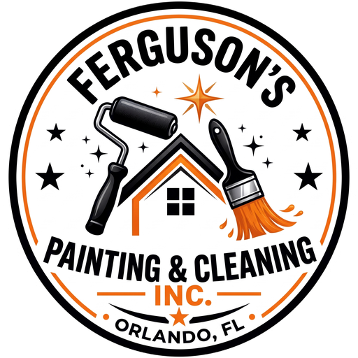
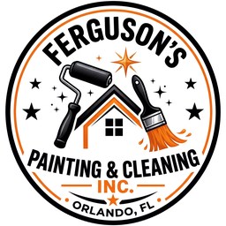
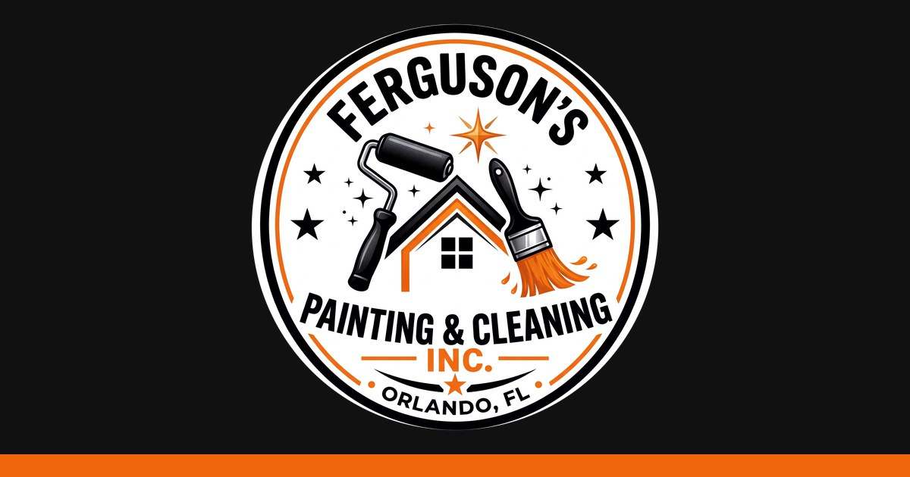

# Ferguson's Painting & Cleaning, Inc. — Website Build Plan

**Domain:** fergusonspainting.com  **Host:** Cloudflare Pages  **Contact email:** derwin@fergusonspainting.com
**Source material:** Facebook page (facebook.com/FergusonsPaintingCleaningAndHomeRepair — read directly, Oct 2026) plus BBB, Birdeye/Google reviews, Houzz, WeFixCelebration
**Plan date:** October 21, 2026

### Decisions log (Randall, Oct 21, 2026)

| Topic | Decision |
|---|---|
| Code repo | GitHub `fergusonspainting/fergusonspainting.com` (public) |
| Hosting | **Cloudflare Worker with static assets** (Oct 21: Cloudflare now labels Pages "legacy"). Config in `wrangler.jsonc`; the quote form runs in `src/worker.js` → `src/quote.js` |
| Domain | Already active on Cloudflare |
| Email | derwin@fergusonspainting.com is a Google Workspace (Gmail) mailbox. Keep Google's MX/SPF records; the quote form sends through **Resend** from `send.fergusonspainting.com` |
| Address | City only ("Orlando, FL"), listed as a service-area business. No street address on the site or in schema |
| Experience | "Serving Central Florida since 2012". No years figure |
| Credentials | "Fully insured". No "licensed" claim |
| Hours | Monday–Friday, 8am–5pm |
| Service area | Orlando, Kissimmee, Celebration, Reunion, Lake Mary + greater Central Florida |
| Site stack | Plain HTML/CSS/vanilla JS, no build step |
| SEO pages (Oct 22) | Based on a review of 11 top Orlando painter/handyman sites: split exterior/interior painting; added popcorn ceiling removal, handyman, a pressure-washing page (renamed from cleaning), city pages for Kissimmee, Celebration, Reunion and Lake Mary, a cost-factors guide, and an HOA/POA section. Breadcrumb, Service and FAQ schema on every page. "HOA or POA" is used everywhere because owners use both terms |
| Projects to cite | Exterior painting of 450 Burma (450burma.com), Encore at Reunion West, with the owner's OK to name and link it. Victorian repaints in Celebration |
| Paint brand | Sherwin-Williams by preference, other brands on request |
| Contact buttons | Call, Email and Free quote on the sticky phone bar and the CTA band on every page |

<p align="center"></p>

---

## 1. Goal

Replace the Facebook page as the business's main web presence with a fast, mobile-first static site that:

1. Gets phone calls and quote requests (the #1 job of the site).
2. Shows real work (52 photos pulled from the Facebook page, in `images/gallery/`) and real reviews.
3. Ranks locally for "painter / pressure washing / home repair / pool deck + Orlando, Kissimmee, Celebration, Reunion, Lake Mary".
4. Costs ~$0/month to host (Cloudflare Pages free tier) and is easy to update.

---

## 2. Business facts gathered

| Item | Value | Source | Status |
|---|---|---|---|
| Legal name | Ferguson's Painting & Cleaning, Inc. | BBB (alt. name), new logo | Confirm |
| Facebook name | Ferguson's Painting, Cleaning and Home Repair | Facebook | Keep as "also known as" for SEO |
| Owner | Derwin Ferguson | Facebook, BBB, reviews | ✅ |
| Phone | (321) 202-7225 | Facebook, BBB, Houzz | ✅ |
| New email | derwin@fergusonspainting.com | Randall | ✅ replaces dfpaintingandcleaning@gmail.com shown on Facebook |
| Address | Street address on file (kept out of this public repo) | Facebook, BBB | ✅ **Not shown publicly**. Site shows "Orlando, FL" only |
| Incorporated | Aug 27, 2012 (corporation) | BBB | ✅ |
| Experience | Facebook: "A complete maintenance service for over 20 years" · Houzz: "over 27 years" | Facebook, Houzz | ✅ Use "Since 2012" instead of a years figure |
| Tagline | "Always a professional, neat and clean service" | Facebook bio | ✅ use as hero tagline |
| Facebook category | House Painting · price "$" · "Always open" · has a **Book now** button | Facebook | ✅ Hours: Mon–Fri 8am–5pm (fix "Always open" on Facebook) |
| Facebook audience | 217 followers · 160 photos | Facebook | — |
| Service area | Orlando, Kissimmee, Celebration, Reunion, Lake Mary (+ greater Central FL) | Houzz, WeFixCelebration, Randall | ✅ Kissimmee & Reunion added Oct 21; more cities welcome |
| Clients | Residential and commercial (retail store, pool & spa store, clubhouse in photos) | Houzz, Facebook photos | ✅ |
| Ratings | **Facebook: 100% recommend (11 reviews)** · **Google: 5.0 ★ (21 reviews)** | Facebook, Birdeye | Re-check counts at build time |
| License / insurance | None listed publicly | BBB, Houzz | ✅ Say "Fully insured" only. No license claim |

### Services (from Facebook photos, listings and reviews)

- **Painting:** exterior siding and stucco repaints, trim, porches and columns, lanais, garage doors, metal roofs, spray finishing, interior walls, wood staining, texturing, wallpaper.
- **Carpentry & decks:** pool decks (posts → framing → boards → stairs → railings/privacy walls), porch steps and railings, cedar columns, cedar ceilings, interior doors. This is a big part of the photo history.
- **Exterior repairs:** wood-rot and sheathing replacement, siding and soffit repair, house wrap, then paint-to-match.
- **Remodeling:** bathroom remodels with stone-look tile showers, staircase tread and riser makeovers, vinyl plank flooring, backsplash and drywall.
- **Cleaning:** pressure washing, mildew and vine removal, janitorial and commercial cleaning.
- **Commercial:** retail store interiors (after-hours prep and protection), commercial decks, clubhouse interiors.

### Reviews from Facebook (verbatim; get each reviewer's OK before publishing)

> "Derwin did an incredible job completing a repair on my house that turned out to be way more work than he or I had ever anticipated. He was very open, honest and professional and gave accurate and helpful feedback throughout the job. The completed work looks great and I am very pleased with the entire situation. I would 100% recommend him to anyone who needs work done on their home. 5 stars."
> — **Jonathan Sullivan**, Facebook, Aug 2020

> "What a great experience! Call just a couple of days ago with a kitchen emergency needing help removing old backsplash and installing new drywall. Derwin was a sympathetic professional who fit me in this same weekend - just two days later! His work is top-notch and I cannot say enough good things about him - professional expert and super helpful and friendly and priced right!"
> — **Vicky Medlock**, Facebook

> "Today was my first time using Ferguson's: Derwin and Robert (his helper) did a good job on my gables today (05/25/2021). = trimmed, re-attached, primed, painted to match, etc = very pleased."
> — **Steve Schwartz**, Facebook, May 2021

> "Superb customer service and great work" — **Chris Ramos**, Facebook
> "5 stars" — **Phil Pikelny**, Facebook

There is also a May 2020 Facebook recommendation from Randall Zapata. If the person building the site wrote it, leave it off the site so the testimonials stay independent.

**Google review themes (Birdeye, 21 reviews):** punctual, professional, honest, fair prices with no hidden costs, clear communication, and coordinates specialists such as plumbers. Reviewers name Derwin plus crew members George and Rob. Copy exact Google review text from the Google Business Profile at build time. Don't paraphrase it or present a paraphrase as a quote.

---

## 3. Brand



| Token | Value | Use |
|---|---|---|
| `--orange` | `#F0640A` (sampled from logo; lighter tone `#EA772B`) | Buttons, accents, links on dark |
| `--black` | `#111111` | Header, footer, headings |
| `--ink` | `#1E1E1E` | Body text |
| `--paper` | `#FFFFFF` / `#FAF7F2` (warm off-white) | Backgrounds |
| `--line` | `#E5E1DA` | Borders |

- **Headings:** a condensed bold sans to echo the logo lettering, either *Oswald* or *Bebas Neue* (Google Fonts).
- **Body:** *Inter* or *Source Sans 3*.
- **Motif:** the logo's sparkle stars (✦) as small section dividers; orange underline bars like the "— INC. —" lockup.
- Orange on white fails contrast for small text (~3.3:1), so use orange for buttons with **black or white bold text ≥ 18px**, and use black for body links.

### Logo assets (in `images/`)

| File | Purpose |
|---|---|
| `logo-original.jpg` | Master file as supplied (2048×2048, white background) |
| `logo-circle-transparent.png` | Full-res circular cutout with transparent corners, for use on any background |
| `logo-1024.png/.webp`, `logo-512.png/.webp`, `logo-256.png/.webp` | Web sizes (header uses 256; hero/about uses 512) |
| `favicon.ico` (16/32/48), `favicon-32.png` | Browser tab icon |
| `apple-touch-icon.png` (180) | iOS home-screen icon |
| `icon-192.png`, `icon-512.png` | Web app manifest icons |
| `og-image.jpg` (1200×630) | Social share preview (Facebook, iMessage, LinkedIn) |



---

## 4. Project photos from Facebook

The Facebook page has **160 photos**. I picked **52** of the strongest and saved them into `images/gallery/<category>/`, with descriptive file names, rotated upright and with black borders cropped off. They are about 1265 px on the long side, which is good for a web gallery. Overview sheets of all 160 photos are in `images/facebook-index/`, so you can pick more.

| Folder | Count | Highlights |
|---|---|---|
| `painting-exterior/` | 21 | Victorian repaints in Celebration (blue, pink), stucco repaints, porch homes, lanais, metal roof |
| `carpentry/` | 11 | Full pool-deck build sequence, cedar columns and ceilings, porch steps |
| `repairs/` | 7 | Wood rot → sheathing → siding → paint-to-match sequence |
| `remodeling/` | 5 | Staircase before/after, tile shower, bathroom, flooring |
| `commercial/` | 4 | Retail store interior, pool & spa store deck, clubhouse |
| `team/` | 3 | Derwin on the job (great for About and hero) |
| `cleaning/` | 1 | Pressure washing and vine removal (**need more cleaning photos**) |

### Featured picks

**Hero candidates (finished exteriors)**


**Before / after pairs**

| Before | After |
|---|---|
|  |  |
|  |  |
|  |  |
|  |  |

**Pool deck build (step-by-step story for the Carpentry page)**


**Craft details and the team**


### Photo clean-up before publishing

- **House numbers are visible** in several photos: `victorian-blue-repaint`, `ranch-repaint-dark-garage-door`, `gray-home-*`, `siding-repair-finished-gray`, `porch-home-painting-in-progress`. Blur them, or get the homeowners' OK first.
- **Store brand names** show in `retail-store-interior-*`, and `pool-store-deck-build` shows another business's name and phone number. Crop them, or get the client's permission and list them as commercial clients.
- Ask Derwin and the crew before using photos of their faces.
- These are copies of the Facebook versions. If Derwin still has the **originals on his phone**, swap them in for sharper images.
- Run the optimizer (§8.4) to make `.webp` full-size and thumbnail versions for the site.

---

## 5. Site map

```
/                     Home
/services/            Services overview
  /services/painting/          Exterior & interior painting, stucco, trim, roofs, staining
  /services/carpentry/         Pool decks, porches, steps & railings, cedar work, doors
  /services/repairs/           Wood rot, siding, soffit & trim repair, drywall
  /services/remodeling/        Bathrooms, tile showers, stairs, flooring, kitchens
  /services/cleaning/          Pressure washing, mildew removal, janitorial & commercial
/commercial/          Commercial work (retail, clubhouses, storefronts)
/gallery/             Project photos (filter by category, before/after pairs)
/reviews/             Facebook + Google reviews and "Leave a review" links
/about/               Derwin's story, years of experience, crew, service area
/contact/             Quote request form, phone, email, service-area map
/thanks/              Form-success page (noindex)
/404.html
```

Every page has a sticky **Call (321) 202-7225** button on mobile and a **Get a Free Quote** button. Point Facebook's **Book now** button at `/contact/`.

---

## 6. Page outlines

### Home
1. **Header:** logo (256px), nav, orange "Free Quote" button; tap-to-call on mobile.
2. **Hero:** `victorian-blue-repaint.jpg` (or the pink Victorian) with a dark overlay. H1 "Painting, Repairs & Pool Decks in Orlando". Subhead "Always a professional, neat and clean service." Buttons: *Call Now* / *Get a Free Quote*. Trust row: 5.0 ★ Google · 100% recommended on Facebook · Serving Central FL since 2012 · Residential & Commercial.
3. **Services grid:** 5 cards (Painting, Carpentry & Decks, Repairs, Remodeling, Cleaning), each with a photo, one line of text and a link.
4. **Before/after slider:** staircase or pink Victorian.
5. **Why Ferguson's:** on time; honest, upfront pricing; neat and clean job sites; fits in emergencies (Vicky's review); one call for many jobs.
6. **Recent work:** 6 gallery thumbnails that link to /gallery/.
7. **Reviews strip:** the Jonathan Sullivan, Vicky Medlock and Steve Schwartz quotes, plus links to Google and Facebook.
8. **Service area:** confirmed cities only.
9. **CTA band (orange):** "Ready for a fresh coat?" plus phone and quote button.
10. **Footer:** logo, phone, email, hours, service area, Facebook link, © Ferguson's Painting & Cleaning, Inc.

### Service pages (one template, five pages)
H1 with a city keyword → what's included (bullets) → 3–6 photos from that gallery folder → process (Estimate → Schedule → Prep & protect → Work → Walkthrough & cleanup) → FAQ (3–5 questions) → quote CTA. The Carpentry page tells the pool-deck story in 5 photos. The Repairs page shows the rot → repair → paint sequence.

### Gallery
CSS grid with lazy-loaded `.webp` images, category filter buttons (no framework needed), before/after pairs side by side, and a simple lightbox (~2 KB of JS, or a `<dialog>`).

### Reviews
Rating summary (Google 5.0 ★, Facebook 100% recommend), verbatim reviews, and buttons: "Review us on Google" (Google Business Profile short link) and "Recommend us on Facebook".

### About
Use `derwin-on-the-job-01.jpg` or `derwin-tile-shower-02.jpg`. Include the story, years in business, residential and commercial work, values, crew and service area.

### Contact
Form fields: name, phone, email, address/city, service (select), project details, preferred contact method, and an optional photo upload (phase 2). Cloudflare Turnstile blocks spam. The form submits to the Worker (`/api/quote`), which emails **derwin@fergusonspainting.com**. Also show phone, email and hours.

---

## 7. Technical stack

| Need | Choice | Why |
|---|---|---|
| Site generator | **Plain HTML + CSS** (or Astro if more pages come later) | Fast, nothing to break, easy for anyone to edit |
| Hosting | **Cloudflare Worker + static assets** (Git-connected) | Free, global CDN, automatic HTTPS, preview URLs |
| Contact form | **Worker script** `src/worker.js` → `src/quote.js` | Serverless, same project |
| Spam protection | **Cloudflare Turnstile** | Free, no CAPTCHA puzzles |
| Email delivery from form | See §9.3 (depends on where the mailbox lives) | |
| Analytics | **Cloudflare Web Analytics** | Free, cookie-less, no banner needed |
| Maps | Static image or Google Maps embed of the service area (not the home address) | |

### Project structure

```
fergusonspainting.com/          # repo root = this folder
├── PLAN.md, README.md, .gitignore
├── images/                     # source photos & logos (not deployed)
├── tools/optimize-images.py    # makes .webp into public/assets/img
├── wrangler.jsonc              # Worker config (serves public/, runs src/ for /api/*)
├── src/
│   ├── worker.js               # routes /api/quote → quote.js, everything else → public/
│   └── quote.js                # form handler → Turnstile verify → Resend email
└── public/                     # static site served by the Worker
    ├── index.html, 404.html
    ├── services/{index,painting,carpentry,repairs,remodeling,cleaning}/index.html
    ├── commercial/ gallery/ reviews/ about/ contact/ thanks/   (index.html each)
    ├── assets/
    │   ├── css/site.css
    │   ├── js/site.js          # nav toggle, gallery filter/lightbox, before/after, form submit
    │   └── img/                # logo-*.webp, og-image.jpg, gallery/<category>/*.webp
    ├── favicon.ico, apple-touch-icon.png, icon-192.png, icon-512.png
    ├── site.webmanifest, robots.txt, sitemap.xml
    ├── _headers                # security + caching headers
    └── _redirects              # short links (www → apex is a Cloudflare Redirect Rule)
```

---

## 8. Build details

### 8.1 SEO essentials (every page)
- Unique `<title>` of 60 characters or fewer, e.g. `Painting & Home Repair in Orlando, FL | Ferguson's Painting & Cleaning`.
- Meta description of 155 characters or fewer, a canonical URL, and Open Graph tags with `og-image.jpg`.
- One H1 per page that names the service and the city.
- Alt text on every photo that describes the job (for example, "Exterior repaint of a two-story Victorian home in Celebration, FL").
- `sitemap.xml` and `robots.txt`; submit to Google Search Console and Bing Webmaster Tools.
- **JSON-LD** on the home page:

```json
{
  "@context": "https://schema.org",
  "@type": "HousePainter",
  "name": "Ferguson's Painting & Cleaning, Inc.",
  "alternateName": "Ferguson's Painting, Cleaning and Home Repair",
  "url": "https://fergusonspainting.com/",
  "logo": "https://fergusonspainting.com/assets/img/logo-512.png",
  "image": "https://fergusonspainting.com/assets/img/og-image.jpg",
  "telephone": "+1-321-202-7225",
  "email": "derwin@fergusonspainting.com",
  "founder": { "@type": "Person", "name": "Derwin Ferguson" },
  "foundingDate": "2012-08-27",
  "areaServed": ["Orlando FL", "Kissimmee FL", "Celebration FL", "Reunion FL", "Lake Mary FL"],
  "address": { "@type": "PostalAddress", "addressLocality": "Orlando", "addressRegion": "FL", "addressCountry": "US" },
  "openingHoursSpecification": [{ "@type": "OpeningHoursSpecification", "dayOfWeek": ["Monday","Tuesday","Wednesday","Thursday","Friday"], "opens": "08:00", "closes": "17:00" }],
  "sameAs": ["https://www.facebook.com/FergusonsPaintingCleaningAndHomeRepair/"]
}
```
Don't add `streetAddress` or `postalCode` (it's a service-area business). Don't add `aggregateRating` markup for reviews shown on the business's own site, because Google ignores it for LocalBusiness self-reviews.

### 8.2 `_headers`
```
/*
  X-Content-Type-Options: nosniff
  Referrer-Policy: strict-origin-when-cross-origin
  Permissions-Policy: camera=(), microphone=(), geolocation=()
  X-Frame-Options: DENY
/assets/*
  Cache-Control: public, max-age=31536000, immutable
```

### 8.3 `_redirects`
```
https://www.fergusonspainting.com/* https://fergusonspainting.com/:splat 301
/quote   /contact/   301
/book    /contact/   301
/fb      https://www.facebook.com/FergusonsPaintingCleaningAndHomeRepair/ 302
```
The www → apex redirect can also be done with a Cloudflare Redirect Rule. Use one method, not both.

### 8.4 Photo optimizer (run locally)
```bash
pip install pillow
python3 - <<'EOF'
from pathlib import Path
from PIL import Image, ImageOps
src, out = Path("images/gallery"), Path("assets/img/gallery")
for p in src.rglob("*.jpg"):
    dest = out / p.parent.relative_to(src); dest.mkdir(parents=True, exist_ok=True)
    im = ImageOps.exif_transpose(Image.open(p)).convert("RGB")
    for w, tag in ((1600, ""), (600, "-sm")):
        c = im.copy(); c.thumbnail((w, w))
        c.save(dest / f"{p.stem}{tag}.webp", quality=80)
EOF
```
This strips location EXIF data (for privacy) and makes full-size and thumbnail versions, keeping the category folders.

### 8.5 Contact form handler (outline)
`src/quote.js` (called by `src/worker.js`):
1. Parse the form data. Reject the submission if the honeypot field is filled.
2. Verify `cf-turnstile-response` with `TURNSTILE_SECRET` (env var).
3. Check that a name and a phone or email are present, and limit field lengths.
4. Send an email to `derwin@fergusonspainting.com` with reply-to set to the customer's email (see §9.3).
5. Return a `303` redirect to `/thanks/`.

### 8.6 Performance & accessibility targets
- Lighthouse ≥ 95 on all four scores (mobile).
- Home page total under 1 MB. Hero image under 200 KB `.webp` with `fetchpriority="high"`; everything else `loading="lazy"`.
- AA color contrast, visible focus states, labeled form fields, tap targets ≥ 44px.

---

## 9. Cloudflare setup (step by step)

### 9.1 Domain → Cloudflare
1. In the Cloudflare dashboard, choose **Add a domain** and enter `fergusonspainting.com` (Free plan).
2. Cloudflare scans the existing DNS. **Check that any existing MX/TXT records for email were imported** before switching.
3. At the registrar, change the nameservers to the two Cloudflare nameservers shown. Wait until the domain shows "Active".
4. Under SSL/TLS, choose **Full (strict)** and enable **Always Use HTTPS**.

### 9.2 Worker (static assets)
Cloudflare now labels Pages "legacy", so the site runs as a Worker with static assets.
1. The site lives in the GitHub repo **`fergusonspainting/fergusonspainting.com`**. Static files are in `public/`, the Worker config is `wrangler.jsonc`, and the form handler is in `src/`.
2. Go to Workers & Pages → **Create application** → **Continue with GitHub**, authorize the Cloudflare GitHub app on the **fergusonspainting** account, and select the repo. Cloudflare reads `wrangler.jsonc`, so leave the build command empty and keep the deploy command `npx wrangler deploy`.
3. Deploy, then test on the `*.workers.dev` URL.
4. Under Settings → **Domains & Routes**, add `fergusonspainting.com` and `www.fergusonspainting.com` as custom domains (Cloudflare creates the DNS records automatically). The Worker must be in the **same Cloudflare account as the domain**.
5. Under Settings → **Variables and Secrets**, add `TURNSTILE_SECRET` and `RESEND_API_KEY` as secrets.
6. In Turnstile, add a widget for `fergusonspainting.com` and put the site key in the form.
7. Enable Web Analytics for the domain.

### 9.3 Email for derwin@fergusonspainting.com
**Decided:** derwin@fergusonspainting.com is a **Google Workspace (Gmail)** mailbox. DNS confirmed Oct 21: MX `smtp.google.com`, SPF `v=spf1 include:_spf.google.com ~all`.

- **Receiving:** keep the provider's MX, SPF and DKIM records exactly as they are. **Do not enable Cloudflare Email Routing**, because it would replace the MX records.
- **Form email:** send through **Resend** (free tier: 3,000 emails/month) from `quotes@send.fergusonspainting.com` to derwin@, with reply-to set to the customer.
  1. In Resend, add the domain `send.fergusonspainting.com` (a subdomain, so it never conflicts with the main mailbox records).
  2. Add the DKIM TXT, SPF TXT and bounce MX records that Resend shows into Cloudflare DNS. They all live on the `send` subdomain and are **DNS only** (grey cloud).
  3. Create an API key with sending access only, and save it as the `RESEND_API_KEY` secret on the Pages project.
- **DMARC:** ✅ added Oct 22: `v=DMARC1; p=none; rua=mailto:derwin@fergusonspainting.com`, then tighten to `quarantine` after a few clean weeks.

---

## 10. Launch checklist

- [ ] Business facts confirmed (§11)
- [ ] Gallery photos cleaned up (house numbers, brand names), optimized to `.webp`; more cleaning photos added
- [ ] Reviewers' OK to quote them; exact Google review text copied
- [ ] All pages built and proofread; the phone number is a `tel:+13212027225` link everywhere
- [x] Form tested end to end Oct 22 (lands in Derwin's inbox; Turnstile + honeypot block spam). Confirm reply-to on the test email
- [ ] Lighthouse mobile ≥ 95; tested on iPhone and Android
- [ ] Custom domain ✅ live; still to do: www → apex redirect rule and Always Use HTTPS
- [ ] Search Console and Bing verified; sitemap submitted
- [ ] **Google Business Profile** updated with the website, new logo, name and email
- [ ] **Facebook page** updated: website link, new logo as profile picture, cover photo, **email changed to derwin@fergusonspainting.com**, **Book now button pointed at /contact/**, hours fixed (currently "Always open")
- [ ] BBB, Houzz, Nextdoor, Birdeye, Yelp and WeFixCelebration listings updated with the new website and email (a consistent name, address and phone helps local SEO)
- [ ] Business cards and truck signage show the new domain

---

## 11. Open questions for Derwin

1. **Public name:** use "Ferguson's Painting & Cleaning, Inc." everywhere, with "& Home Repair" only in descriptions? (The logo drops "Home Repair".)
2. ~~**Address:**~~ ✅ City only, as a service-area business.
3. ~~**Hours:**~~ ✅ Mon–Fri 8am–5pm. *(Still open: is emergency or weekend work available?)*
4. ~~**Licensing/insurance:**~~ ✅ "Fully insured", with no license claim.
5. ~~**Years of experience:**~~ ✅ "Since 2012".
6. **Service area:** Orlando, Kissimmee, Celebration, Reunion and Lake Mary confirmed. Any other cities or neighborhoods to add?
7. **Services to highlight or drop:** is janitorial work still offered? Is pool-deck building a service to push? Popcorn ceilings: ✅ offered. Stucco repair: ✅ offered (page added Oct 22). Cabinet painting, fence/deck staining: offered? (Competitors have pages for them.)
7a. **Pool decks and remodeling scope:** structural deck building and some remodeling can need a Florida contractor license or permits. Confirm what Derwin does himself, so the copy stays accurate.
7b. ~~**Paint brands:**~~ ✅ Sherwin-Williams by preference, other brands on request. No partnership or certification claim.
7c. ~~**450 Burma:**~~ ✅ The owner OK'd naming and linking the home.
8. **Free estimates?** Payment methods? Senior or military discounts?
9. ~~**Email hosting:**~~ ✅ Google Workspace (Gmail) mailbox; the form sends via Resend.
10. **Photos:** OK to use the selected photos? Any customer homes or commercial clients to exclude? Originals on his phone? More pressure-washing and cleaning photos?
11. **Quote requests:** where should they go besides email, for example a text message alert?

---

## 12. Phases & effort

| Phase | Work | Est. |
|---|---|---|
| 1 | Answers to §11, photo clean-up, Cloudflare domain and email setup | 1–2 days (mostly waiting) |
| 2 | Build Home, Services and Contact with the form; deploy to pages.dev | 1 day |
| 3 | Gallery, Reviews, About, Commercial, SEO/JSON-LD, polish | 1 day |
| 4 | Domain cutover, testing, listing updates (Google Business Profile, Facebook, BBB and others) | ½ day |
| Later | Blog/tips page, online booking, Spanish version, photo upload in the quote form | optional |

**Running cost:** $0/month for Cloudflare Pages, Turnstile, Analytics and Email Routing; about $10–15/year for domain renewal; a transactional email free tier if needed.

---

### Sources
- Facebook page: https://www.facebook.com/FergusonsPaintingCleaningAndHomeRepair/ (About, Reviews and Photos tabs)
- BBB profile: https://www.bbb.org/us/fl/orlando/profile/painting-contractors/fergusons-painting-cleaning-and-home-repairs-0733-90332336
- Birdeye (Google reviews): https://reviews.birdeye.com/fergusons-painting-cleaning-and-home-repairs-165073578503060
- Houzz: https://www.houzz.com/professionals/painters/ferguson-s-painting-cleaning-and-home-repair-pfvwus-pf~1478306091
- WeFixCelebration: https://wefixcelebration.com/listing/fergusons-painting-cleaning-and-home-repairs/
